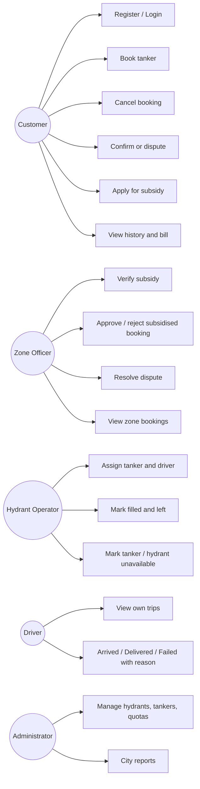

# PaaniLink – Frontend (Phase 1)

Water tanker booking and dispatch UI. Plain HTML, CSS and JavaScript. **No backend.**
Open `index.html` (or host on GitHub Pages). All screens load data with `fetch('/api/...')`.
`mockapi.js` answers those calls from `localStorage`. **Phase 2:** delete `mockapi.js`; the same URLs then hit the real API.
Reset demo data: run `resetMockDb()` in the browser console.

Demo users (password `1234`): `customer`, `mosque` (verified subsidy), `officer`, `operator`, `driver`, `driver2`, `admin`.

## Files
`index.html` shell · `style.css` responsive (360 px to laptop) · `app.js` router, views, validation · `mockapi.js` mock API

## Use case diagram

## Booking status flow
`PENDING_APPROVAL` (subsidised) or `APPROVED` (commercial) → `ASSIGNED` → `FILLED` → `ARRIVED` → `DELIVERED` → `CONFIRMED` / `DISPUTED` → `RESOLVED`. Side exits: `CANCELLED`, `REJECTED`, `FAILED`.
Allowed actions per role and status are served by `GET /api/rules`, and the UI only shows those buttons.

## API contract (all except login/register/zones/rules need `Authorization: Bearer <token>`)
| Method & path | Role | Body / query | Success | Errors |
|---|---|---|---|---|
| POST /api/auth/login | any | username, password | 200 token, user | 401 |
| POST /api/auth/register | public | name, cnic, phone, address, zoneId, username, password | 201 | 409 duplicate CNIC / username |
| GET /api/zones, /api/rules | public | – | 200 | – |
| GET /api/me | any | – | 200 user, monthUsed | 401 |
| GET /api/hydrants, /api/tankers, /api/drivers, /api/rates | logged in | – | 200 list | 401 |
| GET /api/bookings | by role (own / zone / hydrant / trips / all) | status, q | 200 list | 401 |
| POST /api/bookings | customer | type, size, hydrantId, date, time, address | 201 | 422 zone, hours, subsidy limit |
| PATCH /api/bookings/:id | by rules | action, reason, tankerId, driverId | 200 | 403 role, 409 wrong status or double booking or quota, 422 reason |
| GET/POST /api/subsidy | customer, officer | category, proof | 200 / 201 | 409 pending exists |
| PATCH /api/subsidy/:id | officer | decision approve/reject | 200 | 403, 404 |
| PATCH /api/tankers/:id, /api/hydrants/:id | operator (own), admin | available, quota (admin) | 200 | 403, 422 |
| POST /api/tankers | admin | plate, size, hydrantId | 201 | 409 plate |
| GET/POST/DELETE /api/users, POST/DELETE /api/zones, PUT /api/rates | admin | user fields / zone name / rates | 200 / 201 | 409 duplicate or in use, 422 bad rate |
| GET /api/reports/summary | admin | – | 200 totals, byStatus, byHydrant | 403 |

## Validation
Required fields, CNIC 13 digits, phone `03XXXXXXXXX`, address ≥ 10 chars, future date, hydrant working hours, plate `KHI-1234`, quota > 0, reason required for Failed/Dispute. Server-style errors from the API are shown in the form.

## Assumptions
1. **Group variation was not stated in `WE_Project.pdf`.** Put its rule in `VARIATION()` in `app.js`; it already runs on every form.
2. Commercial bookings are auto-approved; subsidised ones wait for the zone officer.
3. A customer sees the assigned tanker plate but never the driver (hidden in the API response).
4. Monthly subsidy limit = 2 bookings (cancelled/rejected not counted). Each hydrant serves the zones listed in `zoneIds`.
5. Quota is consumed when a tanker is assigned; tanker and driver cannot be assigned twice for the same date and time.
6. A Failed trip or Disputed booking is closed by the zone officer with "Mark resolved".
7. Rates are per tanker size and per booking type; prices are in Rs.
