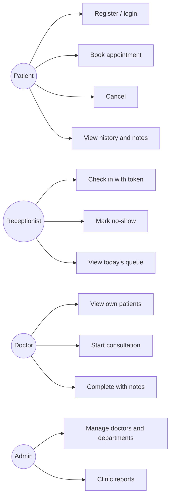

# ClinicQ – Doctor Appointment & Queue Management (Frontend, Phase 1)

Plain HTML, CSS and JavaScript. **No backend.** Open `index.html`. Every screen loads data with `fetch('/api/...')`;
`mockapi.js` answers those calls from `localStorage`. **Phase 2:** delete `mockapi.js`, the same URLs then hit the real API.
Reset demo data: run `resetMockDb()` in the browser console.

Demo users (password `1234`): `patient`, `patient2`, `reception`, `doctor`, `doctor2`, `admin`.

## Files
`index.html` shell · `style.css` responsive (360 px to laptop) · `app.js` router, views, validation · `mockapi.js` mock API

## Status flow
`BOOKED` → `CHECKED_IN` (token given) → `IN_CONSULTATION` → `COMPLETED`. Side exits: `CANCELLED` (patient), `NO_SHOW` (receptionist).
Allowed actions per role and status come from `GET /api/rules`.

## Use case diagram

## API contract (token in `Authorization: Bearer`)
| Endpoint | Role | Input | Errors |
|---|---|---|---|
| POST /api/auth/login, /register | public | credentials / patient data | 401, 409 |
| GET /api/rules, /api/departments | public | – | – |
| GET /api/me, /api/doctors?dept= | logged in | – | 401 |
| GET /api/slots?doctorId&date | logged in | – | 404 |
| GET /api/appointments | by role | status, date, q | 401 |
| POST /api/appointments | patient | doctorId, date, time, reason | 409 slot taken, duplicate, past date |
| PATCH /api/appointments/:id | by rules | action, notes | 403, 404, 409, 422 |
| GET /api/queue | receptionist, doctor | – | 403 |
| POST /api/doctors, /api/departments | admin | doctor / name | 409 |
| GET /api/reports/summary | admin | – | 403 |

## Assumptions
1. **Group variation not given in the brief:** put the rule in `VARIATION()` in `app.js` (runs on every form).
2. A patient can hold one active appointment per doctor per day; a slot can hold one appointment.
3. Check-in is only possible on the appointment day; the token is the next number for that doctor.
4. The receptionist never sees medical notes (hidden in the API response); the patient sees own notes.
5. Each doctor has one daily schedule (start, end, slot length) used for every day.
